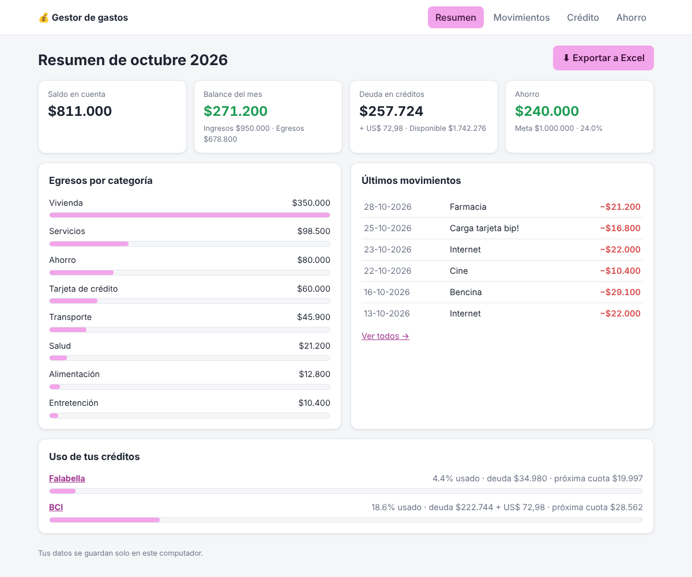
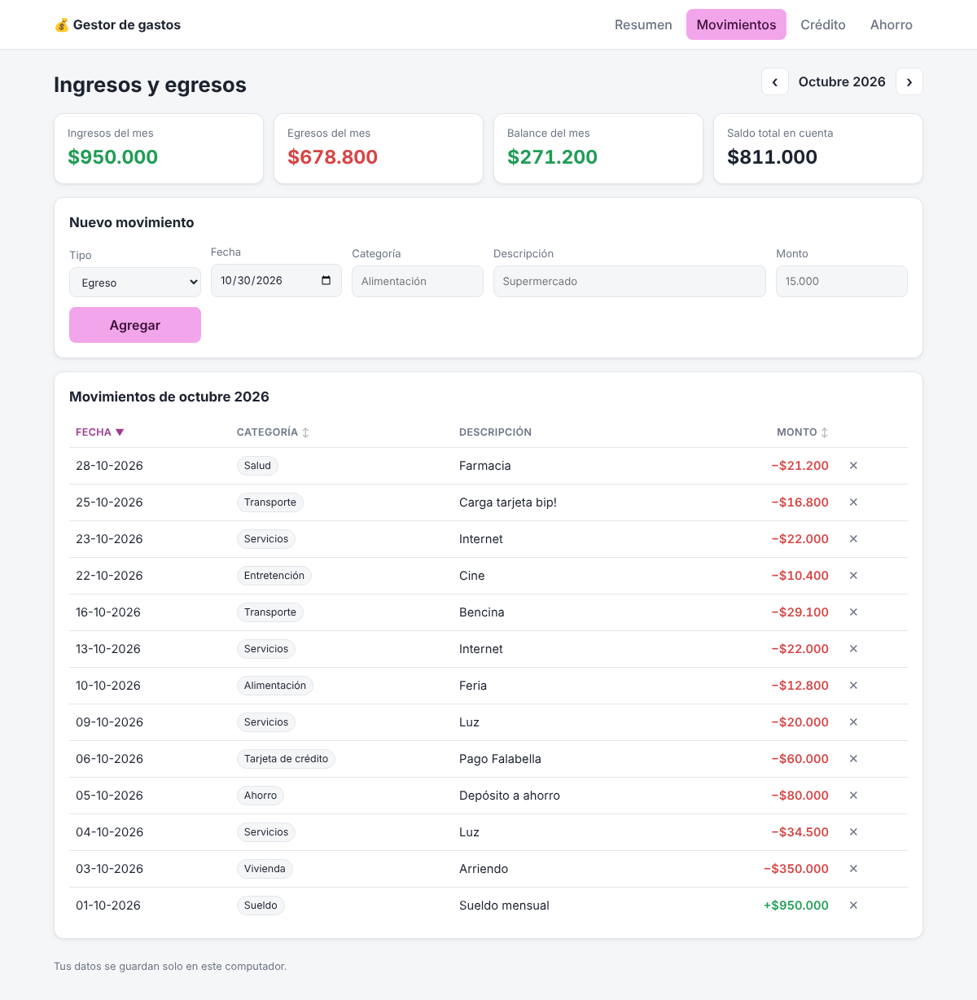
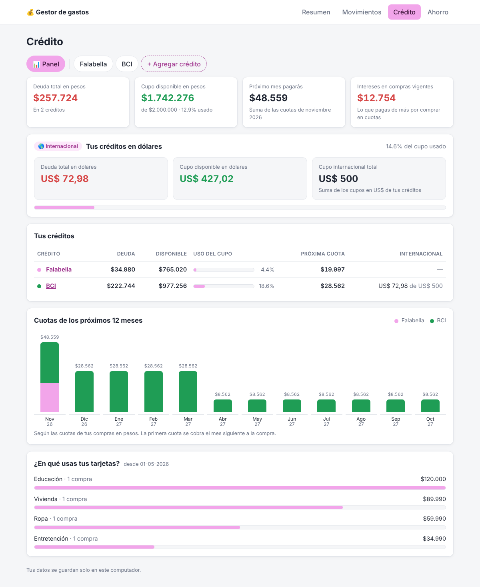
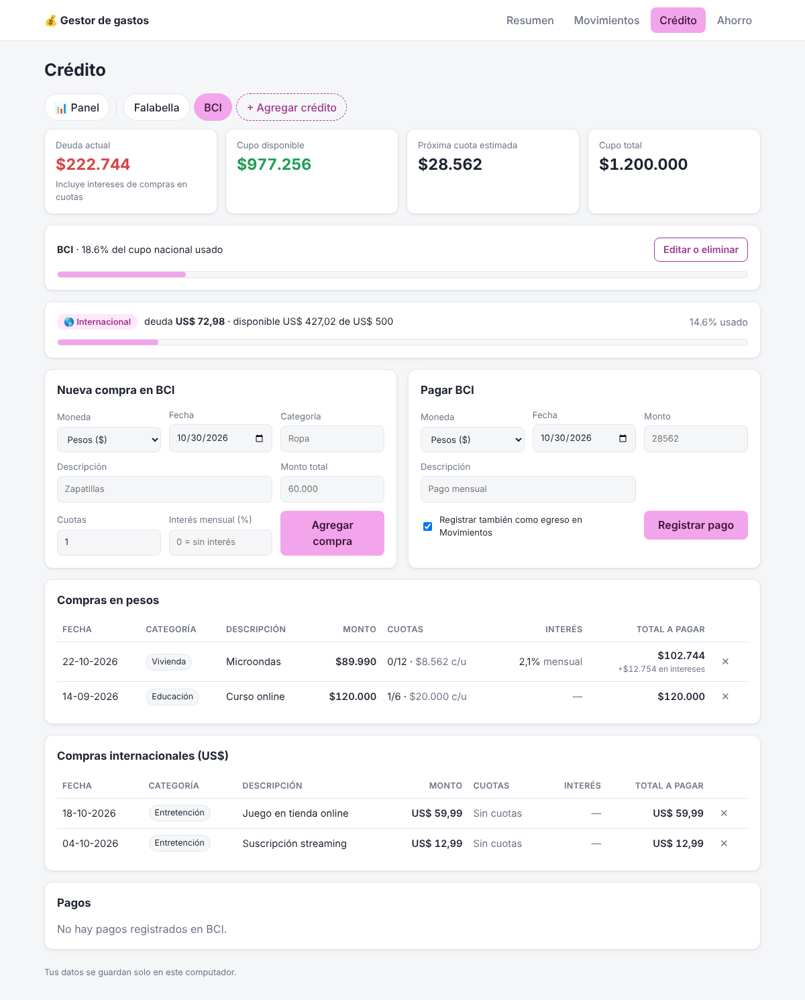
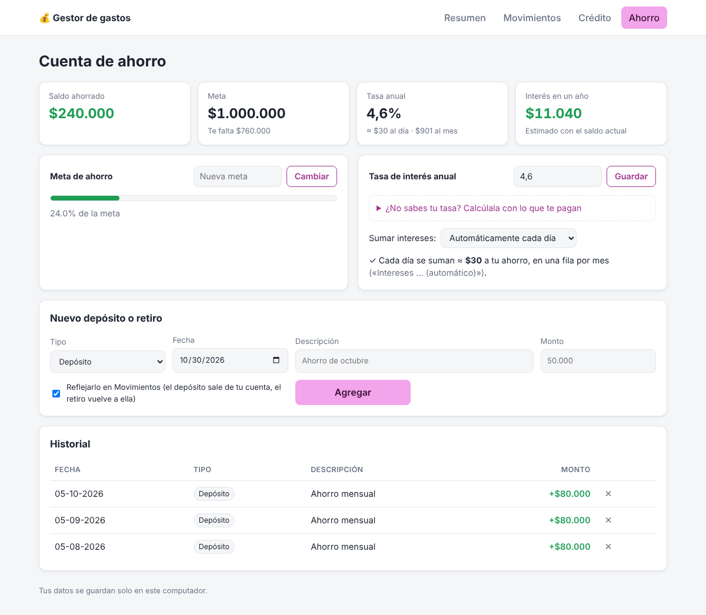

# Gestor de gastos

Programa de escritorio para llevar las finanzas personales, hecho con **Python, Flask, SQLite y pywebview**. Se abre en su propia ventana (no en el navegador) y funciona sin internet. Tiene tres secciones:

| Sección | Qué hace |
|---|---|
| **Movimientos** | Registra ingresos y egresos por categoría, con balance mensual y saldo total. La tabla se ordena por fecha, categoría o monto. |
| **Crédito** | Un panel con el total de tus créditos, el calendario de cuotas de los próximos 12 meses y en qué categorías usas las tarjetas. Varias tarjetas o líneas de crédito (ej. Falabella, BCI), cada una con su cupo, compras en cuotas con interés y pagos. Soporta compras internacionales en dólares con cupo propio. Calcula deuda, cupo disponible y la próxima cuota estimada. |
| **Ahorro** | Registra depósitos y retiros, con una meta de ahorro. Los intereses se pueden sumar solos cada día o cada mes. |

Además, una página de **Resumen** junta lo más importante del mes y permite **exportar todo a Excel**.



<details>
<summary>Más capturas</summary>






</details>

> Las capturas usan datos ficticios (`python main.py --demo`).

## Características

- Montos en pesos chilenos (`$15.000`); acepta escribir `15000`, `15.000` o `$15.000`.
- Exportación a Excel (.xlsx) con una hoja por sección, fechas y montos con formato.
- Navegación por mes en los movimientos; clic en Fecha, Categoría o Monto para ordenar (y otra vez para invertir). El formulario recuerda el último tipo y fecha usados.
- Compras en hasta 48 cuotas con interés mensual opcional (cuota fija, sistema francés). Muestra cuántas cuotas van cobradas y cuánto se paga en intereses.
- Cupo internacional en dólares por tarjeta: compras y pagos en US$ por separado de los pesos, como en el estado de cuenta del banco. Al pagar dólares puedes anotar cuántos pesos costó.
- Tasa anual de ahorro: puedes escribirla o calcularla con lo que te paga el banco (ej. "$15 al día"). Los intereses se suman solos cada día o cada mes, sin perder decimales por redondeo.
- Pagos de tarjeta y depósitos de ahorro pueden reflejarse automáticamente como movimientos de la cuenta; si los borras, el movimiento vinculado también se borra.
- Validaciones: no deja pagar más que la deuda ni retirar más de lo ahorrado.
- Funciona sin internet; los datos nunca salen de tu computador.
- Modo oscuro automático. Los gráficos se dibujan con HTML y CSS, sin librerías externas.
- Tests con `pytest` y GitHub Actions.

## Instalación

Requiere Python 3.10 o superior. En Windows 10/11 no necesitas nada más (usa Microsoft Edge WebView2, que viene incluido).

```bash
git clone https://github.com/Daijinn-BKR/gestor-gastos.git
cd gestor-gastos

python -m venv venv
# Windows:      venv\Scripts\activate
# macOS/Linux:  source venv/bin/activate

pip install -r requirements.txt
```

## Uso

```bash
python main.py           # abre la app con tus datos
python main.py --demo    # abre la app con datos ficticios, en una base aparte
```

## Crear el ejecutable (.exe)

Para abrir la app con doble clic, sin tener Python instalado:

```bash
pip install -r requirements-dev.txt
python build.py
```

El programa queda en `dist/GestorGastos.exe`. Puedes moverlo a donde quieras o crear un acceso directo en el escritorio. El ejecutable se genera para el sistema donde corres el script (en Windows sale un `.exe`).

> En la primera ejecución, Windows SmartScreen puede mostrar un aviso porque el programa no está firmado. Haz clic en *Más información → Ejecutar de todas formas*.

## ¿Dónde se guardan mis datos?

En una carpeta de tu usuario, **fuera del proyecto**, así que es imposible subirlos a GitHub por error:

| Sistema | Carpeta |
|---|---|
| Windows | `%APPDATA%\GestorGastos\gastos.db` |
| macOS | `~/Library/Application Support/GestorGastos/gastos.db` |
| Linux | `~/.local/share/GestorGastos/gastos.db` |

Para respaldar tus datos, copia ese archivo. El modo demo usa `demo.db` en la misma carpeta.

Cuando una nueva versión cambia la estructura de la base de datos, la app guarda antes una copia automática (`gastos.respaldo-FECHA.db`) y luego actualiza tus datos.

### Modo desarrollo

Como la interfaz está hecha con Flask, también puedes abrirla en el navegador mientras programas (con recarga automática):

```bash
flask --app gestor run --debug
```

## Tests

```bash
pytest -v
```

Cada test usa una base temporal, así que no afecta tus datos.

## Estructura

```
gestor-gastos/
├── main.py              # abre la app en una ventana de escritorio
├── build.py             # genera el ejecutable con PyInstaller
├── gestor/
│   ├── __init__.py      # crea la app Flask
│   ├── rutas.py         # carpeta de datos según el sistema operativo
│   ├── db.py            # conexión SQLite, migraciones y comandos init-db / seed
│   ├── schema.sql       # tablas
│   ├── calculos.py      # cuotas, intereses, deuda y tasas (sin base de datos)
│   ├── exportar.py      # genera el archivo Excel
│   ├── utils.py         # formato de pesos, validaciones
│   ├── seed.py          # datos ficticios
│   ├── views/           # una ruta por sección
│   ├── templates/       # HTML (Jinja2)
│   └── static/          # CSS
├── tests/
├── docs/                # capturas para este README
├── requirements.txt
└── requirements-dev.txt
```

## Ideas para seguir

- Editar registros (hoy solo se agregan y eliminan).
- Gráfico de evolución mensual.
- Botón para respaldar y restaurar la base de datos.
- Varias metas de ahorro.
- Presupuesto por categoría con alertas.

## Licencia

MIT
